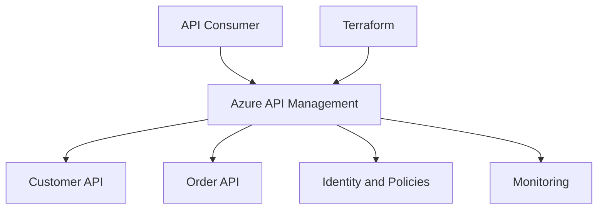

# Enterprise Azure API Management Platform

Local-first enterprise APIM learning project.

## Topics
- Azure API Management and OpenAPI
- Terraform modules
- Microsoft Entra ID and JWT security
- Products, subscriptions, versions and revisions
- Key Vault, CI/CD, monitoring and troubleshooting
- Automated tests and engineer labs

## Architecture

## Safety
Local validation only. No Azure deployment or GitHub push without approval.
Never commit credentials, secrets, or Terraform state.
