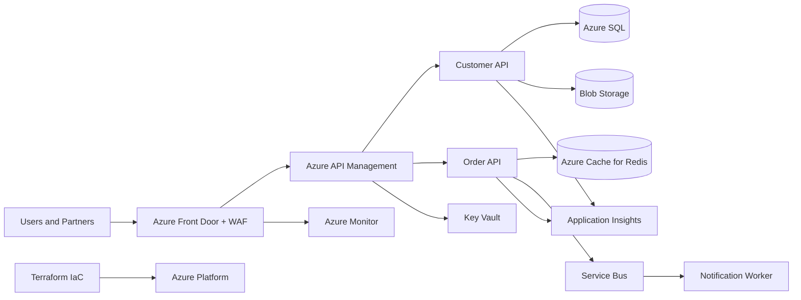

# Enterprise Azure API Management Platform

This repository is a complete enterprise-ready reference implementation for an Azure API platform with secure ingress, private backends, resilient data services, asynchronous workflows, and automated delivery. It starts from the existing APIM-local sample and extends it into a production-style architecture with Terraform, application services, architecture governance, and application CI/CD.

## What is included
- Azure-first architecture for multi-region HA and disaster recovery
- Secure Internet-facing entry point using Azure Front Door, WAF, and APIM
- Private networking patterns for internal services and private endpoints
- Customer and order API services implemented as FastAPI applications
- Asynchronous integration worker for event-driven processing
- Terraform reference infrastructure for Azure resources
- Monitoring, Key Vault, RBAC, Azure Policy, and FinOps guidance
- CI/CD pipeline for build, validation, security, and deployment promotion
- Detailed architecture and operations documentation with diagrams

## Architecture overview

## Project layout
- [docs/architecture/enterprise-platform-reference.md](docs/architecture/enterprise-platform-reference.md) — complete requirements matrix, service decisions, rationale, and diagrams
- [docs/deployment/azure-cicd.md](docs/deployment/azure-cicd.md) — build, release, and deployment strategy
- [docs/deployment/aks-deployment-plan.md](docs/deployment/aks-deployment-plan.md) — AKS rollout strategy and runtime topology
- [docs/runbooks/operations-runbook.md](docs/runbooks/operations-runbook.md) — operational model, alerts, and response playbook
- [terraform/reference-platform](terraform/reference-platform) — full Azure reference infrastructure in Terraform
- [kubernetes/aks](kubernetes/aks) — Kubernetes manifest templates for AKS deployment
- [.github/workflows/azure-platform-cicd.yml](.github/workflows/azure-platform-cicd.yml) — application and infrastructure CI/CD workflow
- [backend/customer-api](backend/customer-api) and [backend/order-api](backend/order-api) — FastAPI service implementations
- [backend/notification-worker](backend/notification-worker) — asynchronous worker service for event-driven processing
- [backend/kafka-sample](backend/kafka-sample) — Kafka producer sample service for event-driven workloads

## Security and safety
- Local validation only unless an explicit Azure deployment approval is recorded.
- Secrets, certificates, and production values must never be committed to Git.
- Use managed identities, Key Vault, RBAC, and private networking by default.
- Use separate dev, test, and prod environments with distinct state and approval gates.

## Architecture and governance
- [Enterprise API architecture](docs/architecture/architecture.md)
- [External API enterprise architecture](docs/architecture/external-api-enterprise.md)
- [Reference platform architecture](docs/architecture/enterprise-platform-reference.md)
- Enterprise API configuration: [terraform/environments/enterprise](terraform/environments/enterprise)
