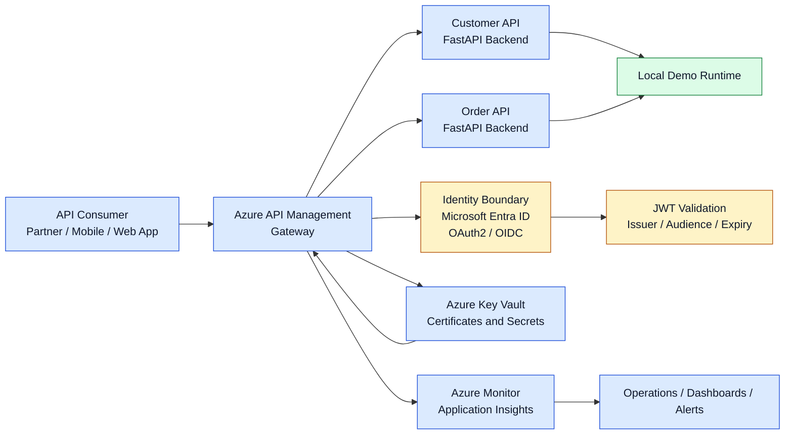

# Enterprise APIM architecture

## High-level flow

## Local demo intent

This repository intentionally separates the local runnable demonstration from Azure-specific production architecture. The local services are designed to run without Azure credentials and are used to validate API contract and behavior.

## Production architecture intent

In a real enterprise Azure environment, the architecture would include:

- API consumers and internal or partner applications
- Azure API Management gateway for routing, throttling, policies, and product isolation
- Customer and Order APIs as backend services behind the gateway
- Microsoft Entra ID for OAuth 2.0 and OIDC validation
- Azure Key Vault for certificates and secret references
- Managed identity for secure downstream authentication
- Azure Monitor and Application Insights for telemetry and diagnostics
- GitHub Actions for validation-only CI and controlled release workflows
- Optional private networking for backend communication and private endpoints

## Distinction between local and Azure

The local code in this repository is not a deployed APIM environment. It is intended to validate:

- contract stability
- backend behavior
- testability
- policy design patterns
- engineering documentation quality

The Azure deployment model and APIM operational configuration are intentionally deferred to a future approved deployment phase.
