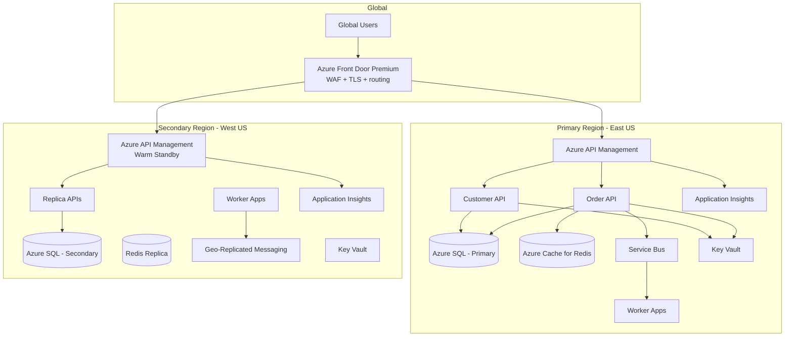
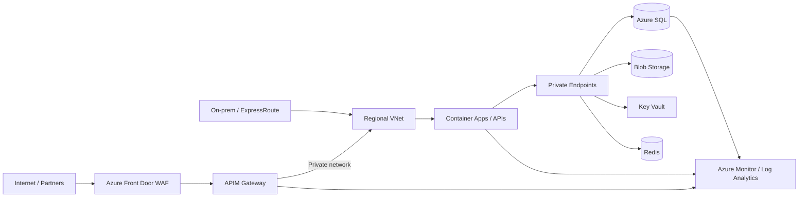
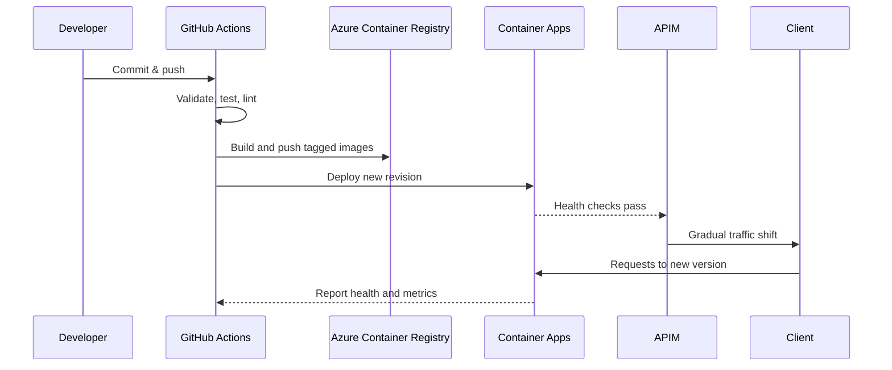

# Enterprise Platform Reference Architecture

## 1. Executive summary
This reference architecture implements a secure, high-availability Azure platform that supports both public internet traffic and internal enterprise workloads. The design uses Azure Front Door and Web Application Firewall (WAF) for global, secure ingress, Azure API Management (APIM) for policy enforcement and versioned APIs, and Azure-native services for data, messaging, monitoring, and identity.

The architecture is intended to satisfy the business requirements for availability, disaster recovery, governance, zero-downtime releases, and secure private access while remaining economic and operationally manageable.

## 2. Business and technical requirement mapping

| Business Requirement | Technical Requirement | Service / Pattern Candidates | Architect's Why |
|---|---|---|---|
| High availability | Eliminate single failure domain | AZ, VMSS, zone-redundant services | Failure tolerance |
| Regional DR | Recover from region failure | Secondary region, ASR, geo-replication | Business continuity |
| <15 min data loss | RPO ≤15 min | Replication / geo-replication | Reduce data loss |
| <1 hour recovery | RTO ≤1 hour | Warm standby | Faster recovery |
| Global users | Low global latency | Front Door / CDN / multi-region | User experience |
| Internet application | Secure ingress | Front Door / App Gateway / WAF | L7 security |
| Internal application | Private access | Internal LB / App Gateway / Private Endpoint | Reduce exposure |
| On-prem integration | Private connectivity | ExpressRoute / VPN | Hybrid connectivity |
| Reliable business messaging | Queue / pub-sub | Service Bus | Decoupling and reliability |
| High-volume streaming | Event stream | Kafka / Event Hubs | Throughput and replay |
| Event notification | Event-driven trigger | Event Grid | Reactive architecture |
| Relational transactions | ACID relational DB | Azure SQL / SQL MI / MySQL / PostgreSQL | Transactional consistency |
| Globally distributed NoSQL | Distributed data model | Cosmos DB | Scale and distribution |
| High read traffic | Reduce DB load | Redis / cache | Performance |
| File / document storage | Object storage | Blob Storage | Cost and scalability |
| Shared filesystem | SMB / NFS style access | Azure Files | Shared storage |
| Frequent releases | Automated delivery | Azure DevOps | Deployment automation |
| Zero downtime deployment | Controlled rollout | Blue / Green / Canary / Rolling | Availability |
| Secret protection | Centralized secret management | Key Vault | Security |
| No public DB exposure | Private network path | Private Endpoint | Network isolation |
| Least privilege | Fine-grained access | Entra RBAC / PIM | Security |
| Governance | Prevent non-compliant resources | Azure Policy | Control at scale |
| Multiple clients | Strong isolation | Subscription / RG / network / RBAC boundaries | Tenant isolation |
| 24x7 support | Operational model | Monitor + ITSM + L1 / L2 / L3 | SLA compliance |
| Cost control | FinOps governance | Budgets / Advisor / Savings Plans | Cost optimization |

## 3. Target topology

## 4. Logical network and security model

## 5. Service decisions and rationale

### 5.1 Edge and ingress
- Azure Front Door Premium with WAF is the global entry point to reduce latency and provide L7 protection.
- APIM provides centralized policy enforcement, API versioning, quotas, JWT validation, and gateway observability.
- A WAF prevents common attacks before traffic reaches the internal business services.

### 5.2 Application hosting
- The business APIs are implemented as containerized FastAPI services using Azure Container Apps for rapid deployment, autoscaling, and low operational overhead.
- Container Apps are paired with private networking and managed identities to avoid public service exposure.
- A small worker service consumes event messages and executes downstream actions without slowing the API path.

### 5.3 Data platform
- Azure SQL Database is the transactional source of truth for customer and order state.
- Azure Cache for Redis powers hot data read paths, session state, rate-limit context, and burst handling.
- Blob Storage supports files, exports, media, and archival artifacts.
- Private endpoints isolate storage and database traffic from the public internet.

### 5.4 Messaging and events
- Azure Service Bus ensures reliable decoupling between API request handling and downstream processing.
- Event-driven patterns reduce throughput pressure on the API layer and improve resilience during spikes or downstream outages.
- The worker process can retry failed operations, dead-letter poison messages, and support audit and notification actions.

### 5.5 Security and governance
- Key Vault stores certificates, secrets, and connection strings; managed identity removes embedded credentials.
- Azure RBAC enforces least privilege across the platform and deployment identities.
- Azure Policy prevents drift and enforces approved regions, naming, tags, encryption, and private networking rules.
- Monitoring and alerting support 24x7 operational coverage and incident response.

## 6. Zero-downtime release model

The release strategy uses phased rollout with traffic shifting, revisioned APIs, and health validation before the new workload fully takes over. This reduces outage risk and supports safe rollback.

## 7. Operational model
- Use Azure Monitor, Log Analytics, and Application Insights as the main observability stack.
- Alert on API latency, 5xx failures, database pressure, message backlog, queue age, and regional health drift.
- Include L1/L2/L3 ownership for incident support and maintain a clear escalation workflow.
- Use budgets, Azure Advisor recommendations, and cost center tags to enforce FinOps discipline.

## 8. Platform decisions summary
1. Public internet access is handled by Front Door plus WAF; APIM enforces security and policy.
2. Private and internal workloads run in VNet-integrated Azure Container Apps and private endpoints.
3. Data is split across SQL, Redis, and Blob Storage by workload characteristics and latency needs.
4. Messaging is isolated to Service Bus to decouple the write path from downstream workloads.
5. All release and infrastructure changes are automated with version-controlled CI/CD and approval gates.
6. Security is centralized through Key Vault, RBAC, and policy guardrails.

## 9. Implementation roadmap
1. Validate Azure landing zone basics and naming standards.
2. Provision a dev environment in Terraform.
3. Deploy base networking, monitoring, and Key Vault.
4. Deploy data services and private endpoints.
5. Deploy application APIs and workers.
6. Integrate APIM and Front Door.
7. Run smoke tests and configure alerts and budgets.
8. Promote through test and production with sign-off gates.

## 10. Design trade-offs
- Front Door plus APIM adds edge protection but slightly increases architecture complexity.
- Private endpoints increase isolation and improve security but require more network design care.
- Redis and Service Bus create a strong operational baseline but require queue depth and cache expiry discipline.
- The architecture optimizes for resilience and secure operations rather than minimal component count.
