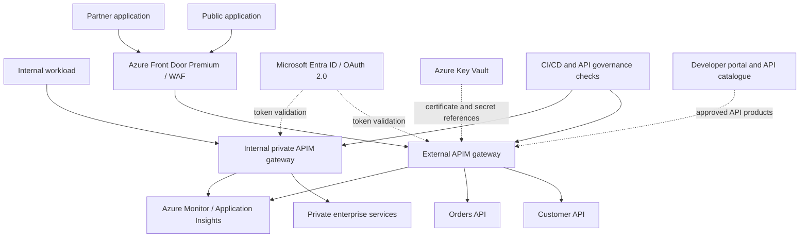

# Enterprise API Management: Internal and External APIs

## 1. Purpose

Extend the platform to govern internal APIs, public consumer APIs,
and business-to-business (B2B) partner APIs through a secure,
API-first lifecycle.

Initial implementation tier: Azure API Management Standard v2.
This is a design and local-code project. Azure resources are not
deployed by these changes.

## 2. Reference architecture

The diagram is logical. The exact ingress, private networking, DNS,
and gateway topology must be validated against the selected APIM tier.

For strict isolation, use separate public/partner and internal-private
APIM instances or gateways with independently enforced network boundaries.
Do not treat products, subscription keys, or URL paths as network isolation.

## 3. API exposure classes

### Public consumer APIs
- Expose only approved operations through the external gateway.
- Use HTTPS and a controlled custom domain.
- Apply WAF protection at the edge where appropriate.
- Validate OAuth 2.0/OIDC access tokens for protected operations.
- Use explicit anonymous access only for intentionally public data.
- Apply operation-level authorization, quotas, rate controls and payload limits.

### B2B partner APIs
- Use OAuth 2.0 client credentials for machine-to-machine integrations.
- Validate token issuer, audience, expiry, scopes and required claims.
- Consider mutual TLS where partner assurance requirements justify it.
- Register each partner application and assign only approved permissions.
- Issue separate credentials per environment; define rotation and revocation.
- Use APIM products/subscriptions for controlled publishing and consumption,
  not as a replacement for identity and authorization.

### Internal private APIs
- Use private connectivity and restrict backend ingress.
- Authenticate workloads with Microsoft Entra ID or an appropriate workload identity.
- Enforce authorization at the API and backend layers.
- Keep internal-only endpoints out of public products and public documentation.
- Test that a public route cannot bypass the intended private access boundary.

## 4. Security baseline

- HTTPS only; manage certificates through an approved certificate lifecycle.
- Validate JWT signature, issuer, audience, expiry and required claims.
- Authorize each operation using scopes, roles or domain-specific permissions.
- Never trust a caller-supplied identity header without a trusted validation path.
- Use rate limits, quotas, payload-size limits and appropriate content validation.
- Do not log access tokens, API keys, passwords or sensitive payloads.
- Store secrets and certificates securely; prefer managed identity where supported.
- Restrict APIM management-plane access using Azure RBAC and least privilege.
- Apply WAF rules at the public edge and monitor blocked requests.
- Restrict backend access so clients cannot bypass the gateway.
- Define credential rotation, emergency revocation and incident-response procedures.

## 5. API products and consumer access

Example product model:

| Product | Audience | Access |
|---|---|---|
| Public-Catalogue | Public applications | Approved read-only operations |
| Partner-Standard | Approved partners | Contracted business operations |
| Partner-Premium | Approved partners | Higher approved usage limits |
| Internal-Services | Internal workloads | Private path and workload authorization |

Product names are examples, not configured Azure resources.
Each product needs an owner, eligibility rules, approved APIs, terms,
rate/usage limits and an operational support contact.

A subscription key identifies a subscription; it is not sufficient
authentication for sensitive business operations.

## 6. API design and versioning

- Treat OpenAPI documents as the contract source of truth.
- Use a consistent naming convention, operation IDs, error model and pagination.
- Define request/response schemas and compatibility rules.
- Use path-based major versions, for example /customers/v1.
- Use APIM revisions for safe non-breaking changes.
- Introduce a new version for breaking contract changes.
- Publish deprecation dates and migration guidance.
- Remove an old version only after owner approval and consumer usage review.

## 7. API delivery pipeline

1. Pull request changes OpenAPI, backend, tests or policy files.
2. Validate OpenAPI JSON and API naming/metadata conventions.
3. Run unit tests, schema/contract tests and security checks.
4. Review APIM policy XML and reject unsafe policy changes.
5. Require code-owner/security approval for externally exposed APIs.
6. Deploy to a non-production APIM environment using CI/CD identity.
7. Run smoke tests and authorization-negative tests.
8. Promote an approved, immutable artifact to production.
9. Verify telemetry, health and rollback readiness.
10. Record the release, approver, API version and artifact revision.

Production publishing must not depend on a developer's personal credentials.
Use workload identity or a managed CI/CD identity with least privilege.

## 8. Governance and ownership

Every API must have:
- Business owner and technical owner
- Exposure classification: public, partner or internal
- Data classification and permitted consumers
- OpenAPI contract and support documentation
- Authentication and authorization requirements
- Service-level objectives and operational contact
- Rate/usage limits and expected traffic
- Versioning and deprecation policy
- Threat model and security review evidence
- Monitoring, alerting and incident runbook

Use Azure API Center or an equivalent governed catalogue for discovery
and inventory across APIs and environments when adopted by the organization.

## 9. Observability and operations

Capture request volume, latency, availability, status-code distribution,
backend failures, throttling, authentication failures and dependency health.

Define alerts for:
- Elevated 5xx rates and backend failures
- Latency or availability SLO violations
- Unexpected traffic spikes and repeated 429 responses
- JWT validation failures and suspicious access patterns
- Certificate expiry and failed deployment/health checks

Use correlation IDs for tracing. Redact secrets and sensitive information
from logs. Define retention, access permissions and incident escalation.

## 10. Local repository implementation plan

Phase 1 — Design and contracts
- Document public, partner and private API boundaries.
- Define OpenAPI conventions and API metadata requirements.
- Add negative tests for missing/invalid JWTs and unauthorized operations.

Phase 2 — APIM configuration as code
- Implement reusable APIM service, API, product and policy modules.
- Add external and internal environment configuration.
- Add reusable JWT validation, rate-control and diagnostic policies.
- Keep sensitive environment values out of Git.

Phase 3 — Governance and CI/CD
- Validate contracts, policy XML, Terraform and security rules in CI.
- Require approvals before production publication.
- Add controlled promotion and rollback procedures.

Phase 4 — Production readiness
- Validate network isolation, custom domains, certificates and DNS.
- Test load, failure recovery, alerting and credential revocation.
- Confirm tier capabilities, quotas, availability and cost requirements.

## 11. Current deployment status

This document describes the target architecture and implementation plan.
It does not create Azure resources or authorize an Azure deployment.
