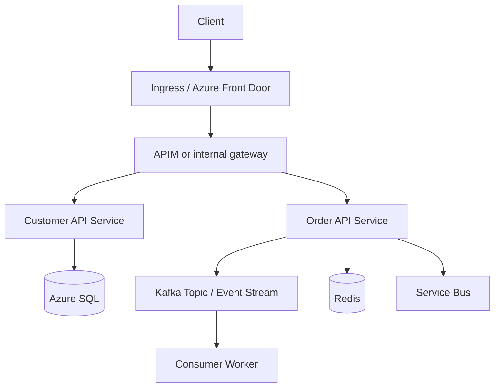

# AKS Deployment Plan

## 1. Goal
The project is designed to be deployed to Azure Kubernetes Service (AKS) for production-style orchestration, autoscaling, and workload isolation. This plan extends the current Azure reference platform concept into a real AKS runtime model.

## 2. AKS topology
Use a multi-zone AKS cluster in the primary region and a secondary AKS cluster or warm standby cluster in the DR region. For this sample, the design uses:

- Primary cluster: `aks-prod-eastus2`
- Secondary cluster: `aks-dr-westus2`
- Node pools: system + workload + monitoring
- Network policy: Azure CNI + Calico or equivalent for egress control
- Private cluster option for internal workloads if required

## 3. AKS workload layout



## 4. Required Azure resources
- AKS cluster
- Azure Container Registry (ACR)
- Azure Key Vault
- Azure SQL Database
- Azure Cache for Redis
- Azure Service Bus
- Log Analytics workspace
- Azure Monitor + Application Insights
- Azure Load Balancer / Ingress Controller
- Azure Front Door for global routing

## 5. Deployment sequence
1. Create AKS cluster and attach ACR.
2. Install NGINX Ingress Controller or Azure Application Gateway Ingress Controller.
3. Create namespace `platform-dev`, `platform-test`, `platform-prod`.
4. Deploy secrets, config maps, and environment variables.
5. Deploy backend APIs and Kafka sample service.
6. Configure health probes, autoscaling, and resource limits.
7. Attach APIM and private networking where required.
8. Enable Azure Monitor + Prometheus/Grafana dashboards.

## 6. Kubernetes manifest guidance
The repository contains AKS manifest examples in [kubernetes/aks](kubernetes/aks). These are deployment templates for:
- Namespace setup
- Config and secret injection
- API deployment manifests
- Kafka sample deployment
- Ingress and service exposure

## 7. Kafka integration on AKS
Kafka is used as a representative high-volume event stream for order events and notifications. In production, prefer a managed service such as Azure Event Hubs or Confluent on Azure. For the sample deployment, the service uses a simple producer pattern with environment configuration.

### Kafka sample environment variables
- `KAFKA_BOOTSTRAP_SERVERS`
- `KAFKA_TOPIC`
- `KAFKA_SECURITY_PROTOCOL`
- `KAFKA_SASL_USERNAME`
- `KAFKA_SASL_PASSWORD`

## 8. Production guardrails
- Use managed identities instead of long-lived service principals.
- Keep secrets in Key Vault and mount them via CSI driver or external secret operator.
- Apply resource limits and autoscaling.
- Use liveness and readiness probes.
- Separate dev/test/prod namespaces and network policies.
- Require approval gates before production deployment.

## 9. Example AKS deployment commands
```bash
az group create --name rg-platform-prod --location eastus2
az aks create \
  --resource-group rg-platform-prod \
  --name aks-prod-eastus2 \
  --node-count 3 \
  --generate-ssh-keys

az aks get-credentials --resource-group rg-platform-prod --name aks-prod-eastus2
kubectl apply -f kubernetes/aks/
```

## 10. Recommended next step
The next implementation phase should add:
- a production-grade ingress controller
- Helm charts or Kustomize deployment layers
- a Kafka consumer worker with retry and DLQ handling
- app-level autoscaling and service mesh policy
- CI/CD deployment through GitHub Actions to AKS
