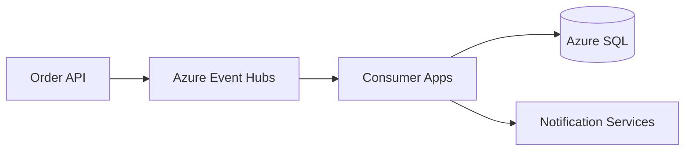

# Azure Event Hubs Option

This project keeps the Kafka sample for local and AKS demonstration, but the Azure-native recommendation for production is Azure Event Hubs.

## Why Event Hubs?
- Durable, high-throughput event streaming
- Native Azure integration with AKS, App Service, and Functions
- Easier managed operations and scaling than self-hosted Kafka
- Strong compatibility with Azure Monitor and governance tooling

## Recommended Azure pattern
- Use Event Hubs as the primary event backbone for order events and customer events.
- Keep Kafka as an integration or migration pattern for teams already using Kafka tooling.
- Use functions or consumers to transform and route events to downstream services.

## Sample topology

## Configuration notes
- Set `EVENTHUB_NAMESPACE`
- Set `EVENTHUB_NAME`
- Use managed identity or SAS tokens with short lifetimes
- Enable diagnostics and alerting for throughput, throttling, and backlog
