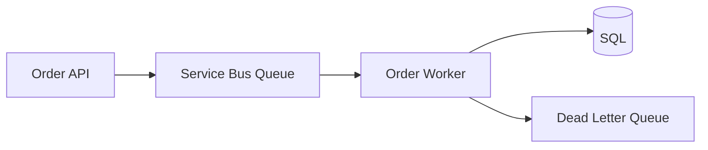
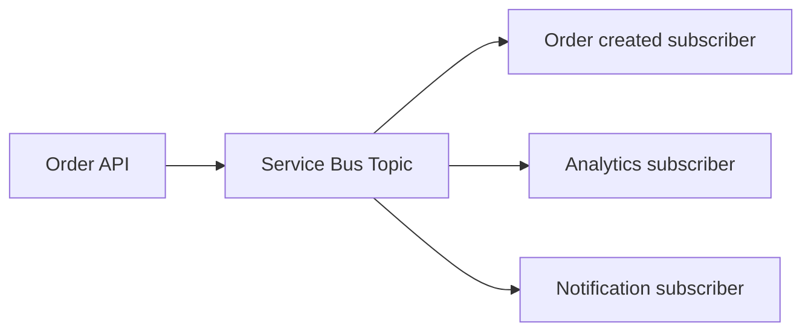
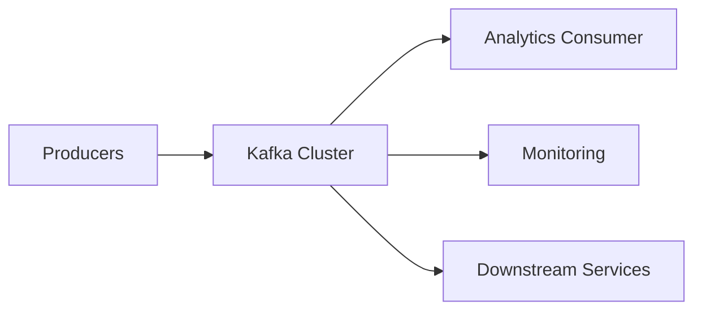
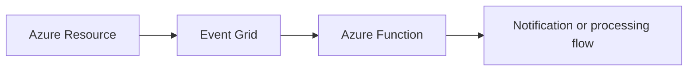

# Azure Hosting Architect – Business Requirement Discovery to Technical Architecture Study Material

## 0. How to Use This Study Material

This module is designed for a technical architect and senior cloud engineer preparing for a Hosting / Cloud Infrastructure Architect interview in an enterprise Azure environment.

The focus is not to memorize Azure service names. The focus is to learn how an architect does the following:
- understands the business problem before touching Azure
- converts vague business intent into measurable technical requirements
- evaluates architecture options
- selects the right Azure services
- considers security, HA, DR, compliance, cost, operations, and supportability
- documents decisions with reasoning and trade-offs

This document is structured in phases and follows a pattern: business context → questions → technical interpretation → architecture options → Azure services → trade-offs → decision → interview answer.

---

## 1. Table of Contents

1. Overview and Learning Roadmap
2. Architecture Requirement Discovery Framework
3. Phase 0: Understanding the Business and Application
   - A. Business Understanding
   - B. Application Discovery
   - C. Current-State Assessment
4. Phase 0.5: Functional and Non-Functional Requirements
   - Availability
   - Performance
   - Scalability
   - Reliability
   - Resilience
   - Security
   - Compliance
   - Data Protection
   - Disaster Recovery
   - Maintainability
   - Observability
   - Interoperability
   - Portability
   - Cost Optimization
   - Operational Support
5. Requirement-to-Technical-Architecture Conversion
   - Detailed requirement conversion pattern
   - 30+ realistic business scenarios
6. Database Architecture and Technology Selection
7. Messaging, Event-Driven Architecture and Integration
8. Compute and Application Hosting Decisions
9. Networking Architecture
10. Azure Landing Zone and Governance
11. Security and Compliance Architecture
12. HA, Backup and Disaster Recovery
13. DevOps and Infrastructure as Code
14. Monitoring and Operational Architecture
15. ITIL, Hosting Operations and Service Delivery
16. Architecture Documentation and Client Communication
17. Real-World End-to-End Case Studies
18. Interview Preparation Section
19. Knowledge Checkpoints and Exercises

---

## 2. Learning Roadmap

### Phase 1: Business discovery and requirement framing
Learn to ask smart questions before suggesting Azure services.

### Phase 2: Functional and non-functional requirement conversion
Learn how to convert business intent into measurable technical metrics.

### Phase 3: Architecture options and technology selection
Learn which services fit which requirement and why.

### Phase 4: End-to-end architecture design
Learn how compute, network, data, messaging, security, and operations fit together.

### Phase 5: Documentation and communication
Learn how to present architecture decisions clearly to clients and leadership.

### Phase 6: Interview readiness
Learn how to answer with structured thinking and real-world rationale.

---

## 3. Architecture Requirement Discovery Framework

Every architecture engagement should start from a consistent discovery framework.

### Architecture discovery template

1. Business objective
2. Business capability and pain point
3. User personas and geography
4. Critical workload and business criticality
5. Current-state architecture
6. Application type and technical stack
7. Functional requirements
8. Non-functional requirements
9. Integration needs
10. Security and compliance needs
11. Data and backup requirements
12. Availability and recovery expectations
13. Cost constraints and budgets
14. Operations model and support coverage
15. Risks, assumptions, and dependencies

### Architect mindset
An architect must always ask:
- What is the business trying to achieve?
- What is the user experience expectation?
- What failure modes are unacceptable?
- What is the cost tolerance?
- What operational model exists or is desired?
- What services are already in place?
- What must be avoided at all cost?

### Simple Hinglish explanation
Business se start karo; Azure se nahi. Azure bas implementation medium hai. Sabse pehle business problem samajho, phir technical solution banao.

### Professional English interview answer
"I begin with business discovery and requirement elicitation before selecting Azure services. The objective is to understand the problem, user expectations, operational model, criticality, and constraints. Only after that do I translate those inputs into measurable technical requirements, architecture options, and final service selection."

---

## 4. Phase 0: Understanding the Business and Application

### A. Business Understanding

#### 1. Business objectives

**Architect question**: What business outcome is this solution expected to achieve?

**Why ask it**: A cloud architecture must support business value, not technology preferences.

**Example client answer**: "We want to reduce processing time for customer onboarding and improve customer experience."

**Technical interpretation**: This implies user-facing workflow, likely API-based application, strong availability, and faster response time.

**Follow-up questions**:
- What is the current SLA or business impact of delay?
- What would happen if the workflow fails for 2 hours?

---

#### 2. Business capabilities

**Architect question**: What core business capability is being enabled?

**Why ask it**: Capability mapping helps to isolate critical functions from supporting services.

**Examples**:
- order management
- claims processing
- customer onboarding
- partner integration
- payment reconciliation

**Technical interpretation**: This helps define critical business services and their dependency model.

---

#### 3. Business-critical applications

**Architect question**: Which applications are business-critical and why?

**Why ask it**: Not all workloads have same availability, DR, or support posture.

**Example answer**: "Core banking and order processing are critical; internal reporting is less critical."

**Technical interpretation**: Different RTO/RPO and cost levels for different workloads.

---

#### 4. Business processes

**Architect question**: What process flow is involved end-to-end?

**Why ask it**: Architecture should support process steps, dependencies, and failure points.

**Example answer**: "Customer places order → verify inventory → reserve stock → payment validation → create order → send notification."

**Technical interpretation**: This suggests integration, asynchronous processing, messaging, and possible retries.

---

#### 5. Revenue-critical workloads

**Architect question**: Which workloads directly contribute to revenue or customer trust?

**Why ask it**: These workloads usually require higher SLA and stricter monitoring.

**Technical interpretation**: Higher resiliency, dedicated compute, lower risk of update failure.

---

#### 6. Internal vs customer-facing applications

**Architect question**: Is this application for internal employees, external customers, or both?

**Why ask it**: Exposure, security, latency, and compliance differ.

**Technical interpretation**:
- external app → public ingress, WAF, DDoS protection, TLS
- internal app → private networking, VNet, private endpoints

---

#### 7. Application ownership

**Architect question**: Who owns the business service and technical service?

**Why ask it**: Ownership drives lifecycle, support model, and accountability.

---

#### 8. Stakeholders

**Architect question**: Who are the stakeholder groups?

**Example**: business sponsor, application owner, platform team, security, DBA, operations, compliance.

**Why ask it**: Requirements must be validated across all decision makers.

---

#### 9. User personas

**Architect question**: Who are the users and what are their needs?

**Why ask it**: Different user behavior means different scale, latency, and Security patterns.

**Example**: customers vs call-center agents vs partner APIs.

---

#### 10. User geography

**Architect question**: Where are users located?

**Why ask it**: Determines regional strategy and latency optimization.

**Technical interpretation**: requirements for Front Door, CDN, global routing, multi-region deployment.

---

#### 11. Business operating hours

**Architect question**: Is the business 9–5, 24x7, or seasonal?

**Why ask it**: This influences autoscaling, support staffing, deployments, and maintenance windows.

---

#### 12. Business growth expectations

**Architect question**: What is forecasted user growth or transaction growth in 12–24 months?

**Why ask it**: Avoids overdesign or underdesign.

**Technical interpretation**: scale-out, autoscaling, capacity planning, storage growth.

---

#### 13. Business continuity expectations

**Architect question**: What business continuity outcomes are expected?

**Why ask it**: This connects to RPO, RTO, DR, and failover strategy.

---

#### 14. Business constraints

**Architect question**: What constraints exist?

Examples:
- budget limits
- compliance obligations
- legacy dependency
- use of specific cloud provider
- database licensing

**Technical interpretation**: constraints directly shape design trade-offs.

---

#### 15. Existing pain points

**Architect question**: What is currently broken or inefficient?

**Why ask it**: It reveals real business pain points and priorities.

**Example**: “Current system slows down during sales season,” or “customers lose orders when the site is unavailable.”

---

### B. Application Discovery

#### New vs existing application

**New application** usually gives more freedom to design cloud-native architecture.

**Existing application** often introduces constraints such as legacy runtime, custom OS, tight DB coupling, monolithic deployment, or old networking assumptions.

**Architect question**: Is this a green-field workload or a modernization of an existing application?

---

#### Monolith vs microservices

**Monolith**
- simpler to start
- easier to operate in small scale
- not ideal for independent scaling or team ownership

**Microservices**
- better for independent scaling and team ownership
- adds network complexity, inter-service issues, observability, and deployment complexity

**Architect question**: Is the application decomposed into domain-driven services or is it a single deployment artifact?

---

#### Three-tier architecture

Typical pattern:
- presentation tier
- application tier
- data tier

This helps understand component boundaries and network segmentation.

---

#### Web applications, APIs, batch processing, background workers

**Web app**: interactive user journeys
**API**: integration and internal service consumption
**Batch processing**: scheduled heavy workflows
**Background workers**: asynchronous processing and decoupling

**Architect interpretation**: Each pattern influences compute, messaging, job scheduling, scaling, and monitoring design.

---

#### Event-driven applications

**Architect question**: Does the system need to react asynchronously to events or workflows?

**Why ask it**: event-driven architecture can improve resilience and scalability.

**Technical interpretation**: Service Bus, Event Hubs, Event Grid, Azure Functions, queue processing.

---

#### Stateful vs stateless applications

**Stateless app**
- easier to scale horizontally
- ideal for web APIs and containers

**Stateful app**
- may require sticky sessions, reliable storage, DB-backed state, cache, or persistence

**Architect interpretation**: impacts load balancer design, session handling, and autoscaling logic.

---

#### Legacy applications

Legacy systems may require:
- VM-based hosting
- private connectivity
- SQL Server compatibility
- specific network or security constraints

---

### C. Current-State Assessment

A good architecture assessment includes As-Is and To-Be.

#### Discover these items
- current Azure subscriptions and management groups
- on-premises DC and network architecture
- existing VNet, subnets, firewalls, VPN, ExpressRoute
- current databases and versions
- existing middleware (APIM, MQ, ESB, enterprise buses)
- current monitoring and backup model
- existing deployment tooling and release rhythm
- current operational teams and support model

#### Business outcome
This tells the architect:
- what can be reused
- what must be replaced
- what must be isolated
- what risks exist in migration

---

## 5. Phase 0.5: Functional and Non-Functional Requirements

### Definition
- Functional requirements say what the system must do.
- Non-functional requirements say how well it must do it.

### Example
Functional requirement:
- User should be able to create an order.

NFR:
- Order creation must complete in under 2 seconds for 95% of transactions.
- System must be available 99.95%.

### NFR categories to explore
1. Availability
2. Performance
3. Scalability
4. Reliability
5. Resilience
6. Security
7. Compliance
8. Data protection
9. Disaster recovery
10. Maintainability
11. Observability
12. Interoperability
13. Portability
14. Cost optimization
15. Operational support

### SLA, SLO, SLI, RTO, RPO, MTTR, MTBF, MTTA

#### SLI
Service Level Indicator: measurable behavior such as request latency or success rate.

#### SLO
Service Level Objective: target value to aim for such as 99.95% availability.

#### SLA
Service Level Agreement: customer-facing commitment.

#### RTO
Recovery Time Objective: maximum time to recover service after outage.

#### RPO
Recovery Point Objective: maximum tolerated data loss window.

#### MTTR
Mean Time To Recover.

#### MTBF
Mean Time Between Failures.

#### MTTA
Mean Time To Acknowledge.

### Example
A customer portal application has:
- 99.9% availability target
- RPO 15 minutes
- RTO 1 hour
- p95 latency < 2 seconds
- MTTR < 30 minutes

These values directly shape architecture decisions.

---

## 6. Requirement-to-Technical-Architecture Conversion

### Standard conversion pattern
Each business requirement should be evaluated in the following sequence:

1. Business Requirement
2. Questions Asked by Architect
3. Why Each Question Is Necessary
4. Possible Client Responses
5. Functional Requirement
6. Non-Functional Requirement
7. Technical Requirement
8. Architecture Options
9. Azure Services
10. Alternative Technologies
11. Why Select a Particular Option?
12. Security Considerations
13. Availability Considerations
14. DR Considerations
15. Performance Considerations
16. Cost Considerations
17. Operational Considerations
18. Risks and Limitations
19. Follow-up Questions
20. Final Architecture Decision
21. Sample Interview Answer

---

### Scenario 1: Application must support 50,000 concurrent users

**Business requirement**: Product site must support a large user base without degradation.

**Architect questions**:
- What user base and peak concurrency is expected?
- Is traffic steady or seasonal?
- Are users mostly read-heavy or write-heavy?
- Is there a global audience?

**Why ask it**: Important to size compute, autoscaling, and global routing.

**Possible client responses**:
- 50,000 concurrent users, 10 million monthly visits, global users
- traffic spikes during campaigns

**Functional requirement**: Users can browse catalog and place orders.

**NFR**:
- 95th percentile latency < 2 seconds
- 99.9% availability
- handle 2x peak seasonal demand

**Technical requirement**:
- multiple regional endpoints
- autoscale front-end and API tier
- load balancing and CDN
- Redis cache for hot reads

**Architecture options**:
- Azure Front Door + App Service / AKS / Container Apps
- multi-region active-active / active-passive

**Azure services**:
- Front Door
- App Service or AKS
- Azure Cache for Redis
- Azure SQL / Cosmos DB depending on data pattern
- Application Insights

**Alternative technologies**:
- VMSS + Application Gateway
- direct public App Service without edge routing

**Why select**:
- Front Door reduces global latency and provides WAF
- App Service / AKS gives elasticity
- Redis reduces load on DB

**Security**: WAF, TLS, managed identities

**Availability**: regional redundancy, health probes, autoscaling

**DR**: secondary region failover

**Cost**: edge + scale-out cost must be optimized with autoscale and region strategy

**Interview answer**:
"This is primarily a scale and latency requirement. I would start by understanding peak concurrency, read-heavy patterns, and region distribution. For a global audience, I would likely use Azure Front Door for global routing and WAF, with a stateless API tier scaled by autoscaling, Redis for hot data, and SQL or Cosmos for persistence. The design would factor in regional failover for availability and cost optimization."

---

### Scenario 2: Application must recover within one hour

**Business requirement**: Service must be recovered within 1 hour after a regional outage.

**Technical requirement**:
- RTO <= 1 hour
- warm standby or active-passive deployment
- automated failover

**Architecture options**:
- active-passive across paired regions
- failover group for SQL
- geo-redundant storage

**Azure services**:
- Azure SQL failover group
- Azure Front Door
- Azure Traffic Manager or Front Door
- Recovery Services Vault
- Azure Site Recovery for VM-based workloads

**Trade-offs**:
- active-passive is cheaper than active-active
- warm standby reduces cost but may increase recovery time if not prepared

---

### Scenario 3: Maximum acceptable data loss is 15 minutes

**Technical requirement**:
- RPO <= 15 min
- geo-replication or continuous backup
- database and storage replication

**Azure services**:
- Azure SQL failover groups or geo-replication
- Storage GRS
- Azure Backup

**Decision**:
- choose data services with built-in replication and recovery features

---

### Scenario 4: Application must integrate with SAP

**Business requirement**: Financial or supply chain data must integrate with enterprise ERP.

**Architect questions**:
- Is SAP on-prem or cloud?
- Is it sync or async integration?
- Are there large files, IDocs, SOAP, or REST APIs?
- What integration pattern is used today?

**Architecture options**:
- API-based integration with APIM
- queue-based integration for async workloads
- dedicated integration layer

**Azure services**:
- APIM
- Service Bus
- Logic Apps or Azure Functions
- Azure Data Factory if ETL integration is involved

---

### Scenario 5: Application needs global user access with low latency

**Business requirement**: Users in North America, Europe, and Asia need fast access.

**Required decisions**:
- global entry point
- active-active or active-passive architecture
- geolocation and health-based routing

**Azure services**:
- Front Door
- Traffic Manager (depending on design)
- regional AKS/App Service deployments
- private connectivity if internal-only

---

### Scenario 6: Business needs asynchronous order processing

**Business requirement**: API should respond quickly; background workflows can happen later.

**Architecture**:
- API writes order event to Service Bus or Kafka
- worker processes event
- retries and DLQ handle exceptions

**Azure services**:
- Service Bus
- Azure Functions or AKS worker set
- Storage for DLQ or process status

**Trade-offs**:
- asynchronous improves UX but requires idempotent consumers

---

### Scenario 7: Business transactions require consistency and no silent loss

**Business requirement**: Banking or financial transactions cannot be silently lost.

**Technical requirement**:
- transactional database with ACID compliance
- message reliability with at-least-once semantics and idempotency
- audit trail and reconciliation

**Azure services**:
- Azure SQL Database
- Service Bus with duplicates detection and DLQ
- Key Vault and managed identities

---

### Scenario 8: Application requires private access for internal users only

**Business requirement**: Internal applications should not be exposed publicly.

**Architecture**:
- private VNet deployment
- internal load balancer or Application Gateway
- private endpoints for PaaS services

**Azure services**:
- VNet, subnet, NSG, Private Endpoint, Private DNS, Firewall

---

### Scenario 9: Application experiences unpredictable traffic spikes

**Business requirement**: e-commerce promotions cause traffic surges.

**Technical requirement**:
- scale-out based on CPU, queue depth, or HTTP concurrency
- queue-based decoupling between public API and processing workers

**Azure services**:
- AKS or Container Apps with HPA
- Service Bus
- Front Door
- Redis

---

### Scenario 10: Multiple clients must have isolated infrastructure

**Business requirement**: Different clients must not share a common database or platform environment.

**Technical requirement**:
- subscription or management group boundaries
- network isolation
- policy enforcement and RBAC segmentation

**Azure services**:
- management groups
- subscriptions
- Azure Policy
- RBAC
- separate VNets / landing zones

---

## 7. Database Architecture and Technology Selection

### A. Database discovery questions

Architect should ask:
- Is the data relational or non-relational?
- Are ACID transactions required?
- Is strong consistency required?
- What is data volume and expected growth?
- What is read/write ratio?
- Are joins required?
- Do we need global distribution?
- Are low-latency reads required?
- Is reporting workload separate?
- Is there regulatory data residency requirement?
- Is data compatibility with SQL Server important?
- What are backup and retention requirements?
- What are RPO and RTO?

### B. Database technology comparison

#### Azure SQL Database
**Ideal for**:
- OLTP workloads
- moderate to high transaction throughput
- managed relational workloads

**When to use**:
- e-commerce transactions, customer data, payment processing metadata

**When not to use**:
- very large unstructured data
- document-first workloads
- globally distributed multi-region low-latency patterns that need dedicated NoSQL design

**Pros**:
- PaaS
- strong consistency
- backup and PITR
- scaling options

**Trade-offs**:
- cost vs VM-hosted SQL
- limited flexibility vs self-managed SQL

---

#### Azure SQL Managed Instance
**Ideal for**:
- legacy SQL Server compatibility
- lift-and-shift scenarios
- native SQL features and cross-db dependencies

**Pros**:
- more SQL Server compatibility
- broad database migration support

**Trade-offs**:
- more cost and operational footprint than Azure SQL Database

---

#### SQL Server on Azure VM
**Use when**:
- OS-level control or custom SQL features are required
- ERP or legacy application requirements demand specific licensing or infrastructure arrangements

**Trade-offs**:
- more responsibility, patching, and backup management

---

#### Azure Database for PostgreSQL / MySQL
**Use when**:
- open-source relational engine compatibility is required
- application stack expects PostgreSQL/MySQL semantics

**Trade-offs**:
- not generic SQL Server replacement if compatibility with SQL Server is required

---

#### Azure Cosmos DB
**Use when**:
- globally distributed low-latency app workloads
- document, key-value, graph, or multi-model patterns
- multi-region writes and low-latency reads

**Trade-offs**:
- cost and eventual consistency if not designed appropriately
- not a replacement for relational transactional systems if strong SQL semantics are required

---

#### Azure Cache for Redis
**Use when**:
- hot data, session state, rate-limits, caching
- reduced DB load

**Trade-offs**:
- ephemeral data model
- not primary data store

---

### C. Database decision matrix

| Requirement | Recommended DB | Why | Alternative | Trade-off |
|---|---|---|---|---|
| Banking transactions | Azure SQL Database | ACID, strong consistency | SQL MI | SQL MI is more compatible but more expensive |
| Global customer profile | Cosmos DB | low latency, global distribution | Azure SQL + geo-replication | more complex multi-model design |
| Cached session data | Redis | low latency | Memory DB / in-app cache | data volatility |
| Product catalog | Azure SQL Database | relational structure | Cosmos DB | Cosmos is good but not needed if relational model fits |
| IoT telemetry | Cosmos DB or Event Hubs + storage | large volume, flexible schema | Azure SQL | cost and complexity of SQL for big telemetry |

---

### D. Database-per-service vs shared database

**Database-per-service**
- better isolation and autonomy
- more operational overhead
- difficult cross-service reporting

**Shared database**
- simpler operations
- more coupling between services
- reduced team independence

**Architect guidance**:
- start with bounded service boundaries
- do not force microservice database separation when not needed
- use separate schemas or data stores only when there is real autonomy and scaling need

---

## 8. Messaging, Event-Driven Architecture and Integration

### A. Messaging requirement discovery questions

- Is asynchronous communication required?
- Do we need producer/consumer decoupling?
- Is guaranteed delivery required?
- Can duplicates occur?
- Is ordering important?
- Are retries needed?
- Is dead-lettering required?
- Is message replay required?
- Are there multiple consumer groups?
- Is throughput high and bursty?

### B. Service Bus vs Kafka vs Event Hubs vs Event Grid

#### Azure Service Bus
**Use for**:
- enterprise messaging
- order processing
- workflow orchestration
- decoupled reliable communication

**Features**:
- queue and topic/subscription support
- DLQ and retries
- transactions and sessions where needed

**Good when**:
- transactional business messages matter
- multiple business workflows exist

---

#### Kafka
**Use for**:
- event streaming and large-scale ingestion
- replayable event streams
- high throughput / distributed consumers

**Good when**:
- open standards / Kafka ecosystem familiarity
- log-based event processing patterns

**Trade-offs**:
- requires operational design, clusters, and more monitoring complexity

---

#### Azure Event Hubs
**Use for**:
- telemetry, event ingestion, real-time streaming
- large throughput at scale

**Good when**:
- millions of event records per second
- ingestion-focused patterns

**Trade-offs**:
- less formal queue semantics than Service Bus
- better for data streaming than transactional workflow processing

---

#### Azure Event Grid
**Use for**:
- lightweight event notifications
- reactive event-driven triggers

**Good when**:
- resource notifications, workflow automation, near-real-time event reactions

**Trade-offs**:
- not recommended for long-running business message processing or large payload processing

---

### C. Decision matrix

| Scenario | Recommended Tech | Why | Alternative |
|---|---|---|---|
| Order processing | Service Bus | reliable workflow | Kafka | Kafka is better for streaming, not core workflow semantics |
| IoT telemetry | Event Hubs | high throughput | Service Bus | more expensive and not ideal for telemetry pipes |
| Resource event notifications | Event Grid | reactive lightweight events | Service Bus | message processing patterns are different |
| Clickstream analytics | Kafka/Event Hubs | large-scale stream ingestion | Service Bus | queue semantics not built for giant replay pipelines |

---

### D. Messaging architecture patterns

#### Queue-based order processing

#### Topic/subscription pattern

#### Kafka stream pattern

#### Event Grid pattern

---

## 9. Compute and Application Hosting Decisions

### Compute decision drivers
- Do we need OS control?
- Is it a containerized application?
- Does it require Kubernetes orchestration?
- Is the workload event-driven and short-lived?
- Is it a web API or background process?
- Is autoscaling required?
- Is legacy compatibility a constraint?

### Azure compute options

#### Azure Virtual Machines
Best for:
- legacy workloads
- custom OS configuration
- tight VM-level dependency

Trade-offs:
- more patching and management

#### VM Scale Sets
Best for:
- stateless enterprise workloads that need horizontal scale

#### Azure App Service
Best for:
- web apps and APIs with platform-managed runtime

#### AKS
Best for:
- complex container platforms
- microservices
- advanced orchestration and network control

#### Azure Container Apps
Best for:
- containerized microservices with moderate operational overhead

#### Azure Functions
Best for:
- serverless event-driven functions
- reactive processing

### Decision matrix

| Requirement | Best fit | Why |
|---|---|---|
| Legacy app with custom OS | VM | OS-level control |
| Quick web app deployment | App Service | managed hosting |
| Microservices with advanced orchestration | AKS | full container lifecycle |
| Lightweight event processing | Functions | scale on event |
| Containerized stateless APIs | Container Apps | less ops than AKS |

---

## 10. Networking Architecture

### Core networking concepts
- VNet and subnet planning
- CIDR design
- NSG to allow or deny flow
- Azure Firewall for centralized egress and inspection
- Application Gateway for L7 load balancing
- Front Door for global edge access
- Load Balancer for internal traffic
- Private Endpoint for PaaS services
- Private DNS for private resolution
- VPN vs ExpressRoute

### Compare key options

#### NSG vs Azure Firewall
- NSG: basic network filtering, subnet and NIC-level rules
- Firewall: centralized application and network policy, more advanced inspection

#### Application Gateway vs Load Balancer
- App Gateway: layer 7 routing, TLS termination, WAF
- Load Balancer: layer 4 traffic distribution

#### Front Door vs Application Gateway
- Front Door: global edge routing and WAF
- App Gateway: regional layer 7 services

#### VPN vs ExpressRoute
- VPN: fast and flexible, internet-based connectivity
- ExpressRoute: more stable and private connectivity for enterprise workloads

---

## 11. Azure Landing Zone and Governance

### Why landing zone matters
Enterprise Azure is not just a single subscription. It is a management model.

### Core governance features
- Management groups
- subscriptions
- Azure Policy
- RBAC
- tagging
- naming conventions
- budget controls
- cost center tagging
- diagnostic requirements

### Landing zone pattern
- management subscription
- connectivity subscription
- shared services subscription
- application landing zones
- identity and security services

### Example client scenario
Multiple business units require isolation.

**Architecture response**:
- separate landing zones per workload or client
- management groups for governance
- separate subscriptions or hubs per security and environment boundaries

---

## 12. Security and Compliance Architecture

### Zero trust principles
- verify explicitly
- least privilege
- assume breach

### Security services
- Microsoft Entra ID
- RBAC
- PIM
- managed identity
- Key Vault
- Defender for Cloud
- Sentinel
- Private endpoints
- Azure Firewall
- WAF
- DDoS protection
- encryption at rest and in transit

### Example requirement conversion
**Business requirement**: Sensitive customer data cannot be public.

**Technical requirement**:
- private endpoints only
- Key Vault for keys and certificates
- restricted NSG rules
- no public SQL access

---

## 13. High Availability, Backup and Disaster Recovery

### Availability vs DR
- HA: keep service available during localized failure
- DR: recover after major regional loss

### Important terms
- RTO: recovery time objective
- RPO: recovery point objective

### Azure services
- Availability zones
- region pairs
- SQL failover group
- Azure Backup
- Recovery Services Vault
- Azure Site Recovery
- GRS / RA-GRS storage

### Example
If business requires RTO 1 hour and RPO 15 minutes, the solution typically includes dual-region deployment, geo-replication, and regular backup validation.

---

## 14. DevOps and Infrastructure as Code

### Key topics
- Azure DevOps or GitHub
- Terraform and Bicep
- modular IaC
- CI/CD gating
- environment promotion
- policy as code
- drift detection
- GitOps patterns

### Example architecture decision
For enterprise scale, use Terraform modules and environment-specific variable files, with CI validation and environment approvals before apply.

---

## 15. Monitoring and Operational Architecture

### Key topics
- Azure Monitor
- Log Analytics
- Application Insights
- Azure Monitor alerts
- custom dashboards
- distributed tracing
- OpenTelemetry
- Prometheus and Grafana where needed

### Example
An online ordering app must alert if:
- p95 latency > 2s for 10 minutes
- 5xx error rate > 5%
- order processing queue length > threshold

This translates into SLO-based monitoring.

---

## 16. ITIL, Hosting Operations and Service Delivery

### Important operational realities
- L1/L2/L3 support model
- incident management
- change management
- release management
- RCA
- P1/P2 incident process
- escalation matrix
- 24x7 support model

### Interview expectation
An architect must think beyond deployment; they must think about supportability, incident ownership, and service continuity.

---

## 17. Architecture Documentation and Client Communication

### Must-have artifacts
- As-Is architecture
- To-Be architecture
- HLD
- LLD
- requirement traceability matrix
- ADRs
- risk register
- TCO estimate
- architecture review deck

### Good architecture communication follows
- business context
- problem statement
- constraints
- assumptions
- trade-offs
- recommendation
- cost and risk summary

---

## 18. Real-World End-to-End Case Studies

### Case Study 1: Retail e-commerce platform
**Business context**: large seasonal peaks and global users.

**Architecture**:
- Front Door + WAF
- App Service or AKS
- Redis for hot reads
- Azure SQL for order data
- Service Bus for async order processing
- Azure Monitor and App Insights
- Geo-redundant storage

**Decision rationale**:
- scale and latency driven by global audience and traffic spikes
- messaging needed for asynchronous fulfillment path

---

### Case Study 2: Banking application
**Business context**: strict compliance, high trust, consistent transactions.

**Architecture**:
- private endpoints and limited public access
- Azure SQL Managed Instance or Azure SQL Database with failover
- APIM or application gateway for controlled access
- Key Vault, Defender, Sentinel, RBAC
- strict backup and DR model

---

### Case Study 3: Order processing and notifications
**Business context**: need to keep API responsive while processing downstream notifications.

**Architecture**:
- API sends event to Service Bus
- worker processes notifications
- DLQ and retries
- separate DB for order state

---

### Case Study 4: Multi-client enterprise landing zone
**Business context**: multiple business units require isolation.

**Architecture**:
- management groups and subscriptions per client
- shared connectivity hub
- environment separation
- central policy enforcement

---

## 19. Interview Preparation

### Basic questions
- What is the difference between functional and non-functional requirements?
- How do you gather requirements from a client?
- How do you decide between app service and AKS?
- What is the difference between HA and DR?

### Intermediate questions
- How do you decide between Azure SQL and Cosmos DB?
- How do you choose between Service Bus and Event Hubs?
- What is the role of Front Door and WAF?

### Advanced questions
- How would you design a global low-latency e-commerce platform on Azure?
- How do you assess whether a multi-region design is needed?
- How do you justify the architecture to a CFO or business leader?

### Good answer structure
**Business context → requirement → architecture decision → why this option → alternatives considered → security → HA/DR → operations → cost/trade-offs.**

### Hinglish explanation
"Business ke objective ko samjho, fir requirement ko quantify karo, phir Azure services decide karo. Sirf Azure service names bolna enough nahi hai; architect ko yeh explain karna chahiye ki kyun us solution ko choose kiya gaya, kis case me alternative better ho sakta tha, aur kis trade-off ko accept kiya gaya."

---

## 20. Key Concepts Learned

- Requirements come before technology.
- Every business ask must be translated into measurable requirements.
- Architecture is about decision quality, not service memorization.
- Security, DR, observability, and cost are first-class design inputs.
- The best solution is the one that satisfies the requirement with acceptable complexity and operational burden.

---

## 21. Knowledge Checkpoint

### 20 interview questions to practice
1. How do you start architecture discovery with a new client?
2. What are the most important questions for a high-availability application?
3. How do you distinguish HA from DR?
4. What makes you select Azure SQL over Cosmos DB?
5. What makes you select Service Bus over Event Hubs?
6. How do you design for global users with low latency?
7. What is the role of Azure Front Door in a host architecture?
8. How do you decide between App Service and AKS?
9. What is the importance of RPO and RTO in architecture design?
10. How do you secure internal-only workloads?
11. What is the role of Azure Policy and RBAC in governance?
12. How do you design for private connectivity with on-premises systems?
13. What is your approach to multi-client Azure landing zones?
14. How do you design a disaster recovery strategy for a business-critical system?
15. What monitoring metrics are essential for an API platform?
16. How do you handle asynchronous processing and retries?
17. What is the risk of choosing Kafka without a business need?
18. How do you document architecture decisions for client reviews?
19. How do you manage cost while maintaining resilience?
20. How do you present architecture decisions to senior leadership?

### 5 scenario-based exercises
1. Design an order processing platform for 100k daily orders with 15-minute RPO and 1-hour RTO.
2. Design a global customer portal for 50k concurrent users.
3. Design an internal enterprise app with no public ingress.
4. Design an event-driven microservice architecture for notifications.
5. Design a multi-tenant Azure landing zone for multiple client workloads.

### Practical client discovery exercise
Use this script:
- Ask business questions first
- Convert each answer into one measurable requirement
- Identify assumptions and missing data
- Propose architecture options
- Select a preferred solution with trade-offs

---

## 22. Final architect positioning

A senior Azure hosting architect is not expected to simply list Azure services. They are expected to:
- ask the correct business and technical questions
- convert vague needs into measurable requirements
- reason through architecture trade-offs
- recommend secure, resilient, supportable solutions
- communicate clearly, justify decisions, and manage risk

This is the true difference between a general cloud engineer and an enterprise Azure Hosting Architect.

---

## 23. Closing Note

This study material should be treated as a working architecture workbook. Use it to practice with real-world scenarios. Every time you answer a question, speak in the sequence:

Business context → requirement → architecture decision → why → alternative → trade-offs → security → operations → cost.

That is how a senior architect thinks and answers.
